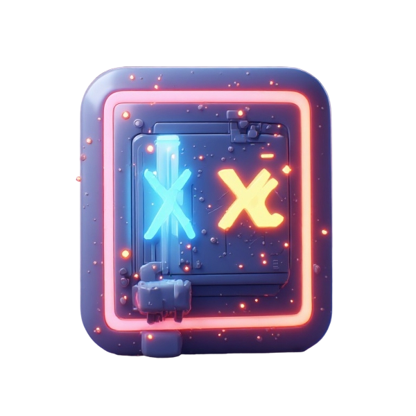

<div align="center">



# XeonLLM

**Run large language models locally on Intel Macs with AMD GPUs.**

Native macOS app · Metal acceleration · No cloud, no accounts, no per-token costs

[](https://github.com/SamerKharboush/xeonllm/releases)
[](LICENSE)
[-lightgrey)](#requirements)
[](https://github.com/SamerKharboush/xeonllm/releases/tag/v0.1.0)
[](#support-the-project)
[](https://doi.org/10.5281/zenodo.21908524)

### [⬇️ Download v0.1.0](https://github.com/SamerKharboush/xeonllm/releases/tag/v0.1.0) · [📝 Changelog](CHANGELOG.md) · [🌐 Project site](https://samerkharboush.github.io/xeonllm-site/)

> ### XeonLLM v0.1.0
>
> **[⬇️ XeonLLM-v0.1.0-noavx2.dmg](https://github.com/SamerKharboush/xeonllm/releases/download/v0.1.0/XeonLLM-v0.1.0-noavx2.dmg)**
> ([release notes](https://github.com/SamerKharboush/xeonllm/releases/tag/v0.1.0) ·
> [checksums](https://github.com/SamerKharboush/xeonllm/releases/download/v0.1.0/checksums.txt))
>
> **This build is x86_64 only. It will not run on Apple Silicon.** There is no arm64 slice,
> and Rosetta cannot help: an Apple GPU never enters the code the AMD workarounds in this
> fork touch — the Metal backend probes a 32-wide SIMD group there, which switches every one
> of them off by construction. On Apple Silicon, install upstream's build instead.
>
> **This `.dmg` is built for AVX-but-not-AVX2 Intel CPUs** (Ivy Bridge and similar, e.g. a
> Xeon E5-2697 v2). A build for AVX2 CPUs dies with "illegal hardware instruction" on those
> machines. The build is ad-hoc signed, not notarized: right-click the app once and choose
> **Open**.

</div>

---

## What is XeonLLM?

XeonLLM lets you run modern open LLMs **entirely on your own Mac** — your chats never leave the machine, there are no accounts, and there's nothing to pay per token.

XeonLLM is a fork of [ToshLLM](https://github.com/engeldlgado/toshllm) by Engelbert Delgado
(GPL-3.0). ToshLLM is what made Intel Macs with AMD GPUs usable for local LLMs in the first
place: the stock engines produce **corrupted output** on AMD dGPUs, and ToshLLM bundles a
`llama.cpp` with AMD-specific patches inside a native SwiftUI app. The table below puts the
stock engine, upstream's engine and this fork's engine side by side. Read the columns as
statements about hardware, not as a race: the two left-hand columns are upstream's own
figures on an RX 6700 XT, the right-hand column is measured on this project's machine, a
Mac Pro 6,1 with two FirePro D700.

| | Stock llama.cpp on AMD dGPU (RX 6700 XT, upstream's figures) | ToshLLM, upstream (RX 6700 XT, upstream's figures) | XeonLLM (Mac Pro 6,1, 2x FirePro D700) |
|---|---|---|---|
| Output | corrupted | correct | correct |
| Qwen3-8B generation | 0.6–2.6 t/s | **~61 t/s** | **10.25 tok/s** decode, tg128 ᵃ |
| Qwen3.6-35B-class MoE generation | unusable | **~29 t/s**, flat on long runs | **13.67 and 14.05 tok/s** decode ᵇ |

ᵃ Method: beta 8 engine, `llama-bench` sha256 prefix `93db3d0cd285ec50`, one card only
(`GGML_METAL_DEVICE_INDEX=1`), Qwen3-8B Q4_K_M, `-ngl 99 -fa 1 -ub 128 -r 5 -p 0 -n 128`,
llama-bench's own warmup discarded; the three processes measured 10.247, 10.248 and
10.247 tok/s.

ᵇ Method: beta 8 engine, `llama-server` sha256 prefix `63eb2a01af361672`, Ornith-1.0-35B Q6_K
(a Qwen3.6-35B-A3B fine-tune), one request per server, 513-token prompt, 128 tokens out,
temperature 0, `-ngl 99 -c 32768 -fa 1 --dynamic-moe on`, both D700s plus the Xeon and RAM;
the two servers measured 13.67 and 14.05 tok/s of decode.

The two left-hand columns are upstream's own published figures for an RX 6700 XT, quoted here
as upstream published them; this project did not measure them. XeonLLM's column is measured
here on beta 8, and the v0.1.0 figures replace it once the release gates have run. The three
columns were measured on different hardware and are **not** a speed comparison between the
engines.

## Same Mac, same models

The same comparison with both engines on this machine, so the hardware is held fixed. Upstream
0.87.33 and XeonLLM beta 8, each app's own bundled binaries, run directly on the Mac Pro 6,1
(Xeon E5-2697 v2, 64 GB, 2x FirePro D700, macOS 15.8) on the same model files. Neither app was
launched: the upstream app has no test-profile option and would write into a user's settings
and data folder. Both engines report llama.cpp build 11429, commit `d81235049`. Engines (sha256
prefixes): upstream `llama-bench` `5977c1a9e6379dcd`, `llama-server` `f3e4ec060b77430c`;
XeonLLM beta 8 `llama-bench` `93db3d0cd285ec50`, `llama-server` `63eb2a01af361672`.

Method, engine level: each app's `llama-bench`, card 1 only (`GGML_METAL_DEVICE_INDEX=1`),
`XEON_FA_AMD=1` (named `TOSH_FA_AMD` in the engines measured here), `-ngl 99 -fa 1 -ub 128 -r 5`, prompt `-p 512,2048`, decode `-n 128` at depth
0 and `-d 2048`; three processes per side, alternating between the two engines; llama-bench's
warmup run discarded. Values are average tok/s per process, all three quoted. Decode at depth
2048 rather than 4096, and `-ub 128` for both engines, because the older engine has no
command-buffer time bound and long GPU command buffers have panicked this Mac.

| model | cell | upstream 0.87.33 | XeonLLM beta 8 |
|---|---|---|---|
| Qwen3-8B Q4_K_M | pp512 | 53.35 / 53.35 / 53.35 | 55.13 / 55.14 / 55.14 |
| | pp2048 | 45.56 / 45.56 / 45.56 | 52.53 / 52.54 / 52.54 |
| | tg128 | 8.27 / 8.27 / 8.27 | 10.25 / 10.25 / 10.25 |
| Qwen3-4B Q4_K_M | tg128 | 14.14 / 14.14 / 14.14 | 16.71 / 16.71 / 16.71 |
| LFM3-1.7B F16 | all | does not load: "unknown model architecture: 'lfm3'" | pp512 254.23-254.44, pp2048 250.00-250.18, tg128 23.06-23.07, tg128 @ d2048 22.46-22.49 |

Method, whole machine: each engine's `llama-server` with the launch beta 8's app chooses for
the model (the same flags and environment for both); one request per server
(`/v1/chat/completions`, 128 tokens out, temperature 0, `cache_prompt: false`); two servers
per side alternating for the short prompt, one server per side for the long prompt. Values are
the server's own `prompt_per_second` / `predicted_per_second` for that request (N = 1 per
server; not benchmarks). The 35B got the short prompt only, because the older engine's
unbounded command buffers rule out the long one.

| model and launch | prompt | upstream 0.87.33 prompt / decode tok/s | XeonLLM beta 8 prompt / decode tok/s |
|---|---|---|---|
| Qwen3-14B Q4_K_M, tensor split over both cards, `-c 16384 -ub 128 -b 128 -fa auto` | 513 | 42.24 / 8.05, 42.20 / 8.06 | 46.13 / 10.00, 46.51 / 10.03 |
| | 2543 | 41.22 / 7.77 | 46.58 / 9.48 |
| Ornith-1.0-35B Q6_K (28.5 GB), `-ngl 99 -c 32768 -fa 1 --dynamic-moe on`, both cards | 513 | 35.63 / 4.23, 35.96 / 4.23 | 62.62 / 13.67, 63.89 / 14.05 |

Text: the 14B answers are byte-identical across all four servers at the short prompt and
between the two engines at the long prompt. On the 35B three answers are identical and one
beta 8 answer differs from character 208 (dynamic MoE places experts differently run to run).
The 128-token cap ends every answer inside the model's reasoning, so this compares speed, not
answer quality. Seen in the logs: the older engine logs `failed to create pipeline state` for
its AMD flash-attention kernels (324 per 14B short-prompt run, 1604 for the long prompt, 12
per 35B run); beta 8 logs none.

These figures were measured on beta 8. The v0.1.0 numbers replace them after the release
gates.

### Who it is for

Intel Macs with discrete AMD GPUs, and in particular the machine this fork is measured on: a
Mac Pro (Late 2013) with a Xeon E5-2697 v2 (AVX, no AVX2), 64 GB of RAM and two FirePro D700
(GCN 1.0, 6 GB each, 64-wide SIMD groups under Metal). Most of the fork's engine work targets
64-lane GCN cards and AVX1-only Xeons; on 32-lane cards it is inert by construction.

### How this differs from upstream

- **An AVX1 engine.** `XEON_AVX1=1 ./scripts/build-engines.sh` builds the engine for CPUs with
  AVX but no AVX2 or FMA, and the `-noavx2` DMG ships it. The build checks the binary for
  AVX2/FMA instructions and refuses one that has any.
- **64-lane Metal kernels for GCN.** Decode mat-vec kernels written for a 64-wide SIMD group,
  with the rows-per-threadgroup and lane-count choices set from measured crossovers on the
  D700 (patches `metal/0055`, `metal/0065`, `metal/0072`, `metal/0074`);
  `XEON_MV_ROWS8_DISABLE=1` restores the older choice.
- **Two cards, two split modes.** Tensor split and layer split across both D700s, with
  cross-GPU peer access and events turned on only where they measured a difference. The two
  modes are different constraints, not two speeds of one thing.
- **A VRAM placement rule.** A model whose weights do not fit the usable VRAM runs on the host
  (`-ngl 0`) instead of thrashing the cards; on the 35B that is the difference between 0.1454
  and 10.1353 generated tok/s (rows R26 and R24 under [Measured on this
  hardware](#measured-on-this-hardware)).
- **DFlash drafting for the host-resident 35B,** with the drafter on a card; from beta.5 the
  drafter keeps its own copy of the borrowed output head on that card (patch `spec/0073`;
  `XEON_DFLASH_HEAD_HOST=1` keeps the old path).
- **In-app updates are off.** The updater polls upstream's releases, which would replace this
  build with one that needs AVX2; fork builds ship with `XEONUpdatesDisabled`.
- **Its own identity.** Bundle id `dev.xeonllm.app`, its own Application Support folder,
  settings domain and Keychain service. The first launch **copies** a previous install's
  settings, data folder and Keychain items; the originals are left untouched.

Every change, with its evidence, is under [Fork changes](#fork-changes).

## Features

- **Native chat** — multiple persistent conversations, full Markdown with code-copy, regenerate, system prompt, live tokens/sec, file attachments, conversation forking and per-message metrics
- **Agent tools and MCP** — the model can read, edit and run files and commands with per-step permission, run JavaScript in a sandbox, and use tools from external Model Context Protocol servers you connect
- **Symbolic math (SymPy)** — optional exact math tools for the model: simplify, solve equations and systems, derivatives, integrals, limits, series, differential equations, matrices, Laplace and Fourier transforms, and checking that two expressions are equivalent or that a solution holds. The runtime ships inside the app, nothing else to install; off by default, in chat settings under Agents ([details](helpers/xeon-sympy/README.md))
- **Scientific computing (NumPy and SciPy)** — optional numerical tools for the model: definite integrals without a closed form, roots, optimization and curve fitting, differential equations over an interval, linear algebra on decimal matrices, FFT and filters, and statistics. The model sends an operation and its numbers, never code. Same bundled runtime, its own switch, off by default ([details](helpers/xeon-scientific/README.md))
- **Math answers you can check** — with either math tool set on, the engine runs the turn itself: a calculation has to go through a tool or a question back, every call is checked against your message, and the answer only states numbers from your message or from a validated result. The app's chat, the web chat and any OpenAI client that sends `X-Xeon-Agent: on` get the same agent, also from another computer; requests that bring their own tools get the model as it is ([how to call it](helpers/xeon-sympy/README.md#four-ways-to-reach-the-tools))
- **GPU speech and subtitle studio** — Whisper.cpp transcribes microphone dictation into one clean paragraph, while the Audio workspace can disable Silero VAD, use Whisper.cpp's native defaults or tune it with calibrated profiles, previews audio or video with a synchronized editable transcript, preserves recoverable original and translated tracks, keeps Chat translation consistent with context and a glossary, and exports SRT, VTT, TXT, JSON or a captioned MOV; nothing leaves the Mac
- **Vision** — attach images (or paste a screenshot with Cmd+V) and vision-capable models describe them; the matching projector (`mmproj`) is paired automatically
- **Image generation (beta)** — a local text-to-image studio (stable-diffusion.cpp on the same AMD Metal stack): text-to-image and image-to-image, with a model catalog sized to your VRAM, a live preview of the image forming, and an **upscaler** that takes your own photos too (x2/x4, batches, and a drag-to-compare view)
- **Model manager** — a curated catalog with **per-model VRAM/RAM estimates for *your* hardware**, plus Hugging Face browsing sorted by trending, downloads, likes or last update, downloads with live progress, and a flag when a repo re-publishes a model you already have
- **MoE-aware** — automatic `--n-cpu-moe` calculation so 35B-class Mixture-of-Experts models run well on 12 GB GPUs
- **Speculative decoding, automatic and lossless** — MTP engages by itself on models that ship the head, and DFlash uses a small per-model draft when one is downloaded; both size themselves to your VRAM, back off on content where drafting doesn't pay, and never change the output
- **Bundled engine** — official llama.cpp with the **AMD Flash Attention kernel** on by default, so attention runs on the GPU instead of falling back to the CPU (see the [research note](#research-amd-gpus-on-metal))
- **Benchmarks** — measure prompt/generation speed per configuration, with history and side-by-side comparison charts
- **OpenAI-compatible API** — use it at `http://127.0.0.1:8080`, with optional local-network access and Bonjour discovery; can also serve embeddings for local RAG clients
- **Router mode** — one server that auto-loads whichever model each OpenAI-compatible request names, no restart between models; external clients and the built-in chat switch on the fly
- **Multiple servers** — run several independent engine instances at once from the Dashboard, each with its own model, GPU, port and profile; serve different models side by side or pin one model per GPU
- **Multi-GPU and eGPU** — split a model across all your GPUs or an exact set of cards (validated on dual-GPU setups); external GPUs run at full speed with VRAM-resident weights
- **Every parameter explained** — tooltips and built-in docs for every setting
- **Profiles, menu bar mode, auto-start** — save full configurations and switch with one click

### In testing 🧪

These are new and still being validated — enable them in Settings, but expect rough edges:

- **Dynamic MoE (off by default)** — for Mixture-of-Experts models that do not fit in VRAM: the most used experts stay in VRAM, the rest in RAM, sized for your context and for the memory the Mac has free right now, and the model is not loaded when nothing fits safely. Off, MoE models use the standard offload as before. [How it works](#dynamic-moe-experimental-off-by-default).
- **Video generation (experimental, first cut)** — a Video mode next to Chat and Images, on the same stable-diffusion.cpp engine, with Wan 2.1/2.2, LTX-2 and HunyuanVideo. Read this before downloading 7 GB: a few seconds of video take minutes, 49 frames at 480p already fill a 12 GB card, and **only Wan 2.1 1.3B fits one at all** — the others ask for 24 GB or more. Asking for more frames or more pixels than fit fails instead of degrading. The clip comes back as frames you can scrub, and exports to mp4. The engine side is measured; the interface is new and the defaults will move.
- **Remember conversations (disk cache)** — persists each chat's KV cache so reopening it, or restarting the app, skips re-processing the prompt; the reload is byte-exact. It also pre-warms the cache for external clients (VS Code/Cline), so their first request skips the cold prefill.
- **Prompt cache reuse** — reuses the cache across mid-prompt edits (coding assistants) and trimmed reasoning instead of reprocessing. Fast but approximate; toggle it off in Settings for exact, reproducible output.
- **Split model across GPUs** — you can pick the exact set of cards per server; on this machine a model that fits the split budget runs across both D700s, and the second card has to be enrolled first (see [Where a 35B belongs on this machine](#where-a-35b-belongs-on-this-machine)). It stays flagged experimental in the UI while more configurations report back.
- **Tensor split (`--split-mode tensor`)** — splits every tensor instead of assigning whole layers per card, so both GPUs work on the same token. Selectable in Settings, next to the fast event hand-off it needs (on by default with a split). It costs one all-reduce per layer, a fixed price per token. Within the all-reduce the transfer is chosen per batch, the Infinity Fabric peer copy for prompts and events for generation. The two split modes are different constraints, not two speeds of one thing; the measured cells are in [Measured on this hardware](#measured-on-this-hardware).

### A native chat that stays out of your way

Persistent conversations, Markdown with one-click code copy, and a live tokens/sec readout so you always know how fast the model is going.

### Models picked for your machine

XeonLLM reads your GPU and RAM and suggests models by use case — fastest, balanced, top quality, coding — each with an honest estimate of how it'll run. Browse a curated catalog or search Hugging Face directly.

### Measure it on your own hardware

The built-in benchmark runs prompt and generation tests for any configuration and charts them side by side, so you can find the sweet spot for your card. XeonLLM's own measured figures on this machine, with their method lines, are in [Fork changes](#fork-changes) and in the two tables at the top of this README.

## Fork changes

Everything below is this fork's own work on top of upstream 0.87.31 (upstream's 0.87.32–0.87.34 changes are ported into it). Measured on a dual-FirePro-D700 Mac Pro (Xeon E5-2697 v2, AVX1 no AVX2, 64 GB RAM).

### Engine defects fixed

**A model with a timestep embedding produced wrong tokens on GCN cards.** The Metal
kernel's odd-dimension branch compiled to the wrong arm for the even dimensions these
models use, so it wrote one row past the row the threadgroup owned: it zeroed the next
row's first element, and on the last row it wrote past the end of the destination into
whatever tensor the allocator put there. A 14B model read a prompt at roughly half the rate it
should and generated the wrong output. The backend suite went from a failure
of 0.0029 relative error to exact.

**Forcing cross-GPU events on a layer split hung the server.** The destination's wait was
encoded into a *new* command buffer, which queued the copy behind whatever the destination
already had. A destination parked on a long graph could not drain the hand-off that graph
was itself waiting on, so the pair stalled until the Metal watchdog killed the buffer —
surfacing as an unexplained `res = -3` with no diagnostic. The wait is now bounded
(`XEON_MGPU_XDEV_TIMEOUT_MS`, default 2000 ms); on timeout it drains both queues, completes
the sequence by hand so the next hand-off is not left waiting on a signal nobody sends,
and falls back to the generic path.

**A memset overran its buffer.** `NSMakeRange(bid_dst.offs, bid_dst.offs + size)` passed an
end offset where a length belongs, so the fill ran `offs` bytes past the region the caller
asked for.

Both engine fixes are in `patches/llama/metal/0035` and `0036`.

### The attention kernel, and the log it used to print

**The 64-lane Flash Attention kernel does not fit on this card, and the host already knew.**
The kernel asks for about 33 KB of threadgroup memory and a GCN 1.0 threadgroup gets 32 KB,
so the driver refuses it. A half-simdgroup twin carries the decode, and forcing the twin
changes nothing (two runs 0.7 of one standard deviation apart). What the AMD attention path
is worth is 8.18% against the generic kernels, 15 standard deviations (row R5 under
[Measured on this hardware](#measured-on-this-hardware)), and it is also what makes a tensor
split work at all: with the AMD path off, the 35B refuses to load under `-sm tensor` and
tells the caller to use a layer split.

**What was wrong was the log, not the kernel.** The refusal was printed as an error by the
shared compile helper, and the prefill path recompiled the refused kernel once per layer per
prompt: one 35B run printed 52 of those errors. The compile helper grew a quiet variant, the
attention path names the kernel it falls back to once per kernel, and a kernel with no
fallback is an error that says so. The same 35B run now prints two warnings, both naming
their fallback, and the decode is the number it was: 6.5073 tok/s prompt eval and 0.1465
tok/s decode on one card (row R1 below), against 6.5625 and 0.1454 for the shipped engine
(row R26).

### App behaviour fixed

**The LAN host toggle did nothing.** `XeonLLMApp.swift` wrote `localNetworkDiscovery` to the
profile but never read it back, and the server's pinned list only ever contained `model`, so
`applyPinned` dropped it. The engine bound to localhost regardless of the setting.

**A fit abort was silent.** When `--fit` gives up, the engine keeps going with the params as
given, so the run looks fine and the lost fitting is only in the log. It now surfaces as a
label next to the plan note.

### Defaults changed

**Splitting across every GPU is now the default on a machine with two or more cards.** A
fresh install previously used a single GPU regardless of the hardware, so a model too large
for one card failed to load and a model that fits was left on one card for no reason. The
default applies only while the setting is unset; turning it off in Settings keeps that
choice.

Two flags are now gated on measurement rather than being offered unconditionally:

- **Cross-GPU peer access** only turns on when the hardware actually reports a bridged peer
  group. On hardware without a bridge it changed nothing, so it now stays off.
- **Cross-GPU events** only turn on for a tensor split. On a layer split they measured the
  same either way, so there is nothing to gain by forcing them on.

The VRAM fit estimator read the split setting with a default of off, so a fresh two-card
machine was sized as if it were single-card. That is fixed too.

### Build fixes

- `ChatTab.swift` and `DesignSystem/Views.swift` used `sharedBackgroundVisibility` and
  `ToolbarSpacer`, which exist only in the macOS 26 SDK. A runtime `#available` is not
  enough — the compiler still resolves the symbol — so the app failed to build on an older
  toolchain. Both are now behind `#if compiler(>=6.2)`, matching what the rest of the app
  already did for `glassEffect`.
- `VideoGenTab.swift` returned an `NSImage` across an actor boundary. The decode now returns
  `[Data]` and the image is built on the main actor.
- `make-app.sh` hard-exited when precompiled Metal kernels were absent. Precompiling them
  needs Xcode's `metal` compiler, which Command Line Tools does not ship. Those three guards
  are now warnings; the engine binaries are still bundled unconditionally.
- `scripts/build-engines.sh` gained a `XEON_AVX1=1` ISA variant for AVX-but-no-AVX2 chips,
  which is what this machine is. Without it the engine is built for AVX2 and dies with SIGILL.

### The fork's engine, measured against itself

Measured on the dual-FirePro-D700 Mac Pro this fork runs on. Method lines are copied from
the release notes or evidence that produced each table, so each table keeps its own
conditions; numbers from different tables are not comparable with each other.

**0.87.31-beta.6** (from [`dist/beta31b6-notes.md`](dist/beta31b6-notes.md)). Method: the
bundled engine (llama-bench sha256 `82725c76…`, llama.cpp `d81235049` plus 88 patches), card
1, `llama-bench -p 0 -n 128 -r 5 -fa 1`, one process per cell, llama-bench discards its own
warmup. A separate CPU-only `llama-server` (14B, `-ngl 0`, idle) was resident during the run.
Each cell is that process's mean of 5 with its sd. Each switch turns off one patch to show it
is in the binary.

| model | default | `XEON_MV_ROWS8_DISABLE=1` | `XEON_FULL_TG_DISABLE=1` |
|---|---|---|---|
| Qwen3-4B Q4_K_M | 16.644 (sd 0.007) | 14.120 (sd 0.006) | 16.599 (sd 0.004) |
| Nemotron-3.5-Bolt-E4B Q4_K_M | 13.752 (sd 0.007) | 11.969 (sd 0.006) | 13.514 (sd 0.009) |

**0.87.31-beta.5** (from [`dist/beta31b5-notes.md`](dist/beta31b5-notes.md)). Method: the dev
tree `build-static` of the same source (llama.cpp `d81235049` plus 84 patches), card 1,
`llama-bench -p 0 -n 128 -r 5 -fa 1`; old and new binaries alternated, two rounds, 4
processes per cell, llama-bench discards its own warmup. "old" is the same tree with the
beta.4 q4_K rule. Each figure is one process's mean of 5.

| model | placement | old tg128 t/s | new tg128 t/s |
|---|---|---|---|
| Qwen3-4B Q4_K_M | one card | 16.145–16.160 | 16.598–16.608 |
| Nemotron-3.5-Bolt-E4B Q4_K_M | one card | 13.011–13.014 | 13.522–13.531 |

The 35B on the host with its DFlash drafter on card 1. Method: dev tree `build-static`
(llama.cpp `d81235049` plus 83 patches, 0073 included), Ornith-1.0-35B Q6_K `-ngl 0 -c 16384
-t 12`, drafter Q8_0, `--spec-draft-n-max 3`, llama-server, 128 tokens greedy, 4 requests per
server with the first discarded, N = 3 per server. The drafter's head on the host
(`XEON_DFLASH_HEAD_HOST=1`) against the copy on the card; two sets run at different times,
reported separately:

| set | head on the host, tok/s | head on the card, tok/s |
|---|---|---|
| A (2 servers per cell) | 11.69–11.85 | 12.35–12.67 |
| B (1 server per cell) | 10.80, 10.75, 10.90 | 11.66, 11.63, 11.80 |

Texts are byte-identical across cells and to plain decoding in both tables.

**Threshold retuning, 0.87.31-beta.4** (from [`dist/beta31b4-notes.md`](dist/beta31b4-notes.md)).
Method: engine `llama.cpp d81235049` plus 82 patches, AVX1 variant; llama-server sha256
`22a21a08...`; `llama-bench -p 0 -n 128 -r 5 -fa 1`, N = 5, llama-bench discards its own
warmup; cells alternated with a 10 s gap. "old" is `XEON_MV_ROWS8_DISABLE=1` on the same
binary.

| model | placement | old tg128 t/s | new tg128 t/s |
|---|---|---|---|
| Qwen3-8B Q4_K_M | one card | 8.26 (0.00) | 10.20 (0.00) |
| Qwen3-4B Q6_K | one card | 12.06 (0.00) | 13.84 (0.00) |
| Qwen3-8B Q4_K_M | tensor split, both cards | 13.81 (0.02) | 16.39 (0.03) |
| Qwen3-4B Q6_K | tensor split, both cards | 16.72 (0.01) | 19.10 (0.02) |

Tensor split rows compare tensor split with itself only, not with layer split or one card.
Text: llama-server, greedy, 256 tokens, two prompts. On one card (8B) and in tensor split (4B
and 8B), old and new are byte-identical.

**0.87.31-beta.3** (from [`dist/beta31b3-notes.md`](dist/beta31b3-notes.md)). Method: engine
llama.cpp `d81235049` plus 81 patches, AVX1 variant, llama-server sha256 `4f87c3d8...`;
`llama-bench -p 0 -n 128 -fa 1`, llama-bench discards its own warmup, cells alternated with a
10 s gap. "old" is `XEON_MV_ROWS8_DISABLE=1` on the same binary.

| model | placement | N | old tg128 t/s | new tg128 t/s |
|---|---|---|---|---|
| Qwen3-8B Q4_K_M | one card | 5 | 8.26 (0.00) | 10.20 (0.00) |
| Qwen3-4B Q6_K | one card | 5 | 12.06 (0.00) | 13.84 (0.00) |
| Qwen3-14B Q4_K_M | layer split, both cards | 3 | 5.08 (0.00) | 6.61 (0.00) |

**Baseline, 2026-09-30** (from [`docs/bench-baseline-2026-09-30.md`](docs/bench-baseline-2026-09-30.md)).
Method: engine 0.87.11, `XEON_NO_AVX2=1`, `GGML_METAL_CONCURRENCY_DISABLE=1`, 12 threads,
`-ngl 99 --load-mode none -fa 1`, `XEON_FA_AMD=1` (named `TOSH_FA_AMD` in the engines measured here); prompt figures are pp512. The tensor and
layer rows are different split modes, not two speeds of one thing.

| model | mode | pp512 t/s | tg t/s |
|---|---|---:|---:|
| Qwen3-0.6B-Q8_0 | single MTL | 368.72 | 51.06 |
| Qwen3-4B-Q6_K | single MTL | 78.70 | 12.00 |
| Qwen3-4B-Q6_K | tensor peer | 141.85 | 17.49 |
| Qwen3-4B-Q6_K | tensor peer+events | 153.36 | 17.49 |
| Qwen3-4B-Q6_K | layer dual (DEVICES=2) | 78.45 | 11.96 |
| Qwen3-14B-Q4_K_M | layer dual (DEVICES=2) | 29.24 | 5.10 |

Per-kernel bandwidth at the moved thresholds, card 1, `test-backend-ops perf`, N = 5, GB/s
(also from `dist/beta31b4-notes.md`):

| shape (k x rows) | old | new | kernel now |
|---|---|---|---|
| q6_K 2048 x 1792 | 28.08 | 38.77 | r8 |
| q4_K 4096 x 8192 | 37.82 | 51.80 | r8 (was L16r8 in beta.3) |
| q4_K 4096 x 10240 | 38.13 | 52.36 | r8 (was L16r8 in beta.3) |
| q4_K 4096 x 12288 | 38.36 | 57.44 | L16r8 |

### Measured on this hardware

Method: every row is one run on this Mac Pro (Xeon E5-2697 v2, 64 GB, 2x FirePro D700) with
the engine named in the row, the model and quant as the row says, one card unless the row
says both, N as the row says. The rows marked `R1` to `R27` are the run ids used by this
fork's release notes and evidence, and each row carries its own method in the third column.
R1, R2, R3 and R19–R22 come from that evidence file; R24–R27 from the app-launch and
shipped-engine comparisons; the last block from `docs/bench-baseline-2026-09-30.md`, whose
method is engine 0.87.11, `XEON_NO_AVX2=1`, `GGML_METAL_CONCURRENCY_DISABLE=1`, 12 threads,
`-ngl 99 --load-mode none -fa 1`, `XEON_FA_AMD=1` (named `TOSH_FA_AMD` in the engines measured here).

| | | |
|---|---|---|
| 35B Q6_K, one D700 (the headless card), the card path | R1 | prompt 6.5073 tok/s, generate 0.1465 tok/s, n=5 |
| 35B Q6_K, both D700s, a tensor split | R3 | generate 0.4387 tok/s, against 0.1465 for the one-device cell |
| the second D700, enrolled by hand | R9 | `GGML_METAL_DEVICES=2` with `GGML_METAL_DEVICE_LIST=0,1` registers it: `ggml_metal: device 1: AMD Radeon HD - FirePro D700`, 3.81 GB of VRAM on it during the two-device decode |
| 35B Q6_K, the `--n-cpu-moe` and `-cmoe` cells | R12 | decode 5.9683 to 10.3336 tok/s, and the output collapses into one token repeated after about 250 characters; 400 generated tokens per cell against the `-ngl 0` reference |
| 35B Q6_K, everything on the host | R2 | prompt 23.4130 tok/s, generate 11.1015 tok/s |
| 35B Q6_K, the launch the app builds, on the host | R24 | prompt 23.1305 tok/s, generate 10.1353 tok/s, the answer is coherent |
| 8B Q4_K_M, the launch the app builds, on the cards | R25 | prompt 39.6722 tok/s, generate 9.0028 tok/s |
| 35B decode, re-faults from the disk | R4 | 52.4 MB over a 219 s decode, 0.24 MB/s, 1.6 MB per token |
| 35B Q6_K, the card path on the shipped engine | R26 | prompt 6.5625 tok/s, generate 0.1454 tok/s, n=5 |
| 35B decode re-faults, on the shipped engine | R27 | 0.293 MB/s, 2.03 MB per token, against an idle control of 24.0 pages/s |
| 27B Q8_0 (28.4 GB), everything on the host | R19 | prompt 4.9964 tok/s, generate 1.5972 tok/s, the answer is coherent |
| 27B Q8_0, one D700 | R20 | generate 0.0883 tok/s, 18x slower, and the answer degenerates into zeros |
| 27B Q8_0, split across the two cards | R21 | the GPU times out during the load; a layer split gives an internal error |
| 27B Q8_0, the shipped build on the host | R22 | every token is zero; this build answers it |
| 8B Q4_K_M, the AMD Flash Attention path off | R5 | 7.6384 tok/s, 8.18% below, 15 sigma |
| 8B Q4_K_M and 35B, this build against the shipped build | R17 | 8B decode 8.2675 against 7.6731 tok/s, 35B host decode 11.1665 against 6.6339 tok/s; the same prompts and flags as R15, one engine after the other |
| 35B, the attention log | R7 | 52 refusal errors before, 2 named warnings after |
| the prefill variant that fits 32 KB | R23 | 8B 39.6 against 40.5 tok/s, 35B 6.68 against 6.66: inside the noise, not carried |
| 8B Q4_K_M, this build against the shipped build | R15 | 6 of 6 prompts identical, 64 tokens each |
| 8B Q4_K_M, a tensor split on the card | R16 | the shipped build aborts; this build runs it at 8.39 tok/s |
| 8B Q4_K_M, the draft on the second card | R13 | 2.6250 tok/s, 138 drafted and 45 accepted, 3.17x slower than not drafting |
| the engine gate | R8 | counts drops, and the forced-drop control reads 1 |
| 14B Q4_K_M, both D700s, layer split | `docs/bench-baseline-2026-09-30.md` | prompt 21.25 tok/s, generate 5.08 tok/s |
| 27B, both D700s, layer split | `docs/bench-baseline-2026-09-30.md` | prompt 11.51 tok/s, generate 6.20 tok/s |
| chat through the shipped binary | `docs/bench-baseline-2026-09-30.md` | coherent, `finish_reason: stop`, 5.05 tok/s |
| engine backend suite | `docs/bench-baseline-2026-09-30.md` | 11682 / 11682 |
| `swift test` | `docs/bench-baseline-2026-09-30.md` | 424 tests, 0 failures |
| first launch to listening, precompiled kernels | `docs/bench-baseline-2026-09-30.md` | 16 s (was 143 s) |

### Where a 35B belongs on this machine

**On the host, not on the card.** The same 35B, the same prompt and the same eight threads
give 0.1465 tok/s on one D700 (R1, 32 generated tokens), 0.4387 tok/s with a tensor split
across both (R3, 8 tokens) and **11.1015 tok/s with everything on the host** (R2, 8 tokens).
Method per row: the table above; the token counts differ because the split and host cells were
run with the placement matrix's shorter decode. Neither card nor host is saturated in the slow
path, so this is not a bandwidth limit: the host holds the 27 GB of weights in the page cache
and re-faults 1.6 MB per token.

The 35B is a 256-expert MoE that uses 8 experts per token. The host path multiplies the 8
experts the token needs; the card path pays for more of the model than the token uses.
This is not a statement about dense models: the 8B decodes at 8.3239 tok/s on the card with no
drafting, and this fork's wave64 work is what makes the card path 7.7% above the generic one
(R17: 8.2675 against 7.6731 tok/s).

**Enrolling the second card changes the 35B's tensor-split decode from 0.1465 to 0.4387 tok/s**
(R3, R9), and the second D700 is not enrolled by default: `GGML_METAL_DEVICES=2` with
`GGML_METAL_DEVICE_LIST=0,1` registers it, and the backend then calls the devices `MTL0` and
`MTL1`.

**`--n-cpu-moe` and `-cmoe` do not compute the model** (R12). The cells that use them decode
between 5.9683 and 10.3336 tok/s against 0.1450 in that same sweep, because the output
collapses into one token repeated to the end of the answer after a correct first paragraph.
The host-only row above is the placement to use, and it is the placement the app now chooses
on its own: see "Where the app puts a model" below.

### A model that does not fit in VRAM belongs on the host too

A dense 27B Q8_0 (28.4 GB) makes the point sharper than the 35B does, because the card
cannot hold it at all. On the host it decodes at **1.5972 tok/s** with a coherent answer
(R19). On one D700 it decodes at **0.0883 tok/s**, 18x slower, and the answer degenerates
into zeros after the first sentence (R20): the card holds 4 GB of a 28.4 GB model, the
host re-faults 128 MB from the disk over the decode, and the card is 26% busy the whole
time. Splitting it across the two cards does not run either: the GPU times out during the
load, and a layer split gives an internal error (R21).

So the rule on this machine is not "big models on the GPU" or "big models on the CPU". It
is: **a model that does not fit in VRAM is not half on the card, it is a model whose every
token crosses the bus, and on this card the answer that comes back is zeros.** The host
has 64 GB and the page cache holds the weights; the cards have 12 GB between them.

The shipped 0.87.26 build answers the same model with zeros on the host (R22), and cannot
run it on the card at all. This build answers it.

### Where the app puts a model

The app resolves the placement before every launch, and the rule is the one the rows give:
**a model whose weights do not fit in the VRAM the run may use runs on the host.** The VRAM
the run may use is the combined VRAM of the cards the run splits across and one card's VRAM
otherwise, less a 1 GB reserve per card, and the host has to have room for the weights, the
KV cache and the compute buffers, or the host is not a fallback either.

| model | weights | the launch the app builds |
|---|---|---|
| 35B Q6_K | 26.56 GiB | `-ngl 0`, no expert offload, no split, no card in the environment (R24) |
| 27B Q8_0 | 27.74 GiB | the same |
| 14B Q4_K_M | 8.38 GiB | `-ngl 99 --split-mode layer` across the two D700s |
| 8B Q4_K_M | 4.68 GiB | `-ngl 99 --split-mode layer` across the two D700s (R25) |

The 35B row is the launch the app builds, run as it is: **10.1353 tok/s** with a coherent
answer (R24), against 0.1465 tok/s for the same model on one card (R1). The 8B row is the
same launch on the cards: **9.0028 tok/s** (R25).

The rule is keyed on the cards this fork measured, the FirePro D700. A card it has not
measured keeps the path it had, because the host link and the decode on it were not
measured.

### Retracted claims

Every claim below was published by this fork and is withdrawn. Each one names the evidence
that replaces it.

- **"A 35B-A3B MoE serves on this build, and it uses the 64 GB."** The `-sm layer` row was
  wrong: the engine answered the health check and then failed the completion with a Metal
  command buffer error (`Compute error. off = 0, n_batch = 2048, ret = -3`), so it did not
  serve. The "device B" columns in the same table were a card the engine never registered.
  *Replaced by* the 35B baseline row above, which is a one-device cell that says so.
- **"Our own flash-attention kernel does not build."** The observation was right and the
  conclusion was wrong. The kernel is refused for the card's 32 KB of threadgroup memory,
  and the host does not lose it: the half-simdgroup twin builds and runs. *Replaced by* the
  attention row above, which measures the twin and the path around it.
- **"The second D700 was starved of budget."** It was never registered. The Metal backend
  registers one device unless it is told otherwise, so every placement cell in this project
  was a one-device cell, and no amount of budget would have changed that. *Replaced by* the
  placement matrix, which enrolls both cards with two environment variables and says which
  cells really had two.
- **The modelled rates.** "7.13 ms/GB", a 94.6 GB/s "marginal rate", an "80/20
  decomposition" and an "18% collective cost" were all withdrawn: each divided by a
  denominator that was itself modelled, and each had residuals far above the measurement's
  own noise. A denominator that is a model is not a measurement.
- **"The 7.7% decode win is compiler flags."** It is code: the fork's own kernels, and the
  same build with the generic path is 7.7% slower.

### Known gaps

- **Intel x86_64 only, by design.** This fork targets Intel Macs with discrete AMD GPUs. No arm64
  slice is built, and the AMD GCN fixes it carries are inert on an Apple GPU by construction: an
  Apple GPU reports a 32-wide SIMD group, which switches every one of those paths off. For Apple
  Silicon, use upstream's release.
- **The build is not notarized**, so macOS quarantines it. Right-click the app once and
  choose **Open**, or `xattr -dr com.apple.quarantine /Applications/XeonLLM.app`. Deferred until
  the release pipeline carries a Developer ID.
- A model whose recurrent-state tensor cannot be divided gets a layer split automatically. The
  engine reports which operation and dimensions refused, and the app says it fell back. There is
  no tensor split to fall back *from* on those models — layers are their only option.
- Cross-GPU events still only apply to a tensor split.
- A 27B Qwen3.5 model cannot be split by tensor: an internal SSM state tensor's width does
  not divide evenly. The engine now names the operation and the dimensions instead of failing
  a bare assertion. Its layer split, which is what that model uses, is unaffected.
- The `NSMakeRange` fix is verified on the production shape but not on a live DSV4 model. Of the
  two callers of the memset in the tree, one always passes offset 0 where the bug is invisible, and
  only `llama-kv-cache-dsv4.cpp:38` passes a non-zero offset. The regression test now reproduces
  that shape and fails on the pre-fix engine, but no DSV4 model was run end to end.

## Install

1. **[Download the `-noavx2` `.dmg`](https://github.com/SamerKharboush/xeonllm/releases/tag/v0.1.0)** from the v0.1.0 release, open it, and drag **XeonLLM** to Applications. It needs a CPU with AVX.
2. The app is fully self-contained — the inference engines ship inside the bundle. No Homebrew, no Python, nothing else to install.

> **First launch:** builds are ad-hoc signed and not notarized, so macOS blocks the first
> open: right-click the app and choose **Open**, or go to **System Settings → Privacy &
> Security** and click **"Open Anyway"**, or run
> `xattr -dr com.apple.quarantine /Applications/XeonLLM.app`. A previous install's settings
> and data folder are copied on first launch and left in place.

> **CPUs without AVX2:** the `-noavx2` build carries the AVX1 engine (Ivy Bridge Xeons such
> as the E5-2697 v2). In-app updates are off in these builds; new versions come from the
> releases page.

## Requirements

- macOS 14 or later
- An Intel Mac with an AMD GPU that supports Metal — measured on a Mac Pro (Late 2013) with a
  Xeon E5-2697 v2, 64 GB of RAM and two FirePro D700 (GCN 1.0, 6 GB each)
- 16 GB RAM minimum — 32 GB recommended for 35B-class MoE models

> **Hackintosh note:** AMD RDNA 2 dGPUs work with the [NootRX](https://github.com/ChefKissInc/NootRX) kext providing Metal support. XeonLLM runs on top of any working Metal setup. Upstream reports that if your OpenCore config injects `ATY,Henbury` in `DeviceProperties`, removing it helped on an RX 6600 XT — a report from a Hackintosh, not a figure this project measured. It was a workaround for macOS 12.3 and is only needed if your displays depend on it.

## Good to know

XeonLLM is at v0.1 and under active development. It is solid for daily use, but you may still hit rough edges — please report anything you find in [Issues](https://github.com/SamerKharboush/xeonllm/issues) (you can export diagnostics from **Settings → Server log**). Two limitations are worth knowing up front:

- **External clients (VS Code Copilot, Cline, Continue…):** these send a fixed 15–19k-token prompt (system instructions + tool definitions) with *every* request. On GPUs without Metal Flash Attention that means minutes of prompt processing per cold request, which saturates the GPU and can thermally throttle it. Recent engine work mitigates this (single slot with resumable prefill, prompt-cache reuse, inline reasoning). The built-in chat isn't affected — it only sends your conversation.
- **Vision cache:** `llama.cpp` does not support saving/restoring slots or cache-reuse while an `mmproj` is loaded. XeonLLM disables those features automatically for vision models; normal in-memory prompt caching still works.
- **Large MoE models on AMD GPUs:** Mixture-of-Experts models that do not fully fit in VRAM cross the CPU↔GPU boundary many times per token. The engine routes small transfers through one persistent staging buffer per device (see [Persistent staging](#persistent-staging-flat-sustained-generation)), which keeps long generations flat instead of slowly starving the AMD driver. A **watchdog** stays in as a safety net, and dense models are still the simplest choice.
- **Vision (image input):** works across the Qwen3-VL family (Qwen3-VL-2B, Qwen3.5-9B, Qwen3.6-14B/35B), Gemma 3 and Gemma 4. The AMD attention kernel covers the vision encoders too (they attend bidirectionally, with no mask, at head dims 64 and 72), so describing an image costs a fraction of the VRAM the fallback path needs. Note that reasoning models (Qwen 3.5/3.6) place the image description in their thinking output, which the in-app chat shows but some external clients may not.

## Build from source

Prerequisites: Xcode Command Line Tools (`xcode-select --install`), CMake.

```bash
git clone https://github.com/SamerKharboush/xeonllm
cd xeonllm
./scripts/build-engines.sh      # clones llama.cpp, applies AMD patches, builds static engines
./make-app.sh                   # builds the SwiftUI app and packages dist/XeonLLM.app
./scripts/make-dmg.sh           # optional: create an installable DMG (version from the VERSION file)
./scripts/test.sh               # optional: run the unit tests (needs Xcode for XCTest)
```

For an AVX-but-not-AVX2 CPU, build the engine with `XEON_AVX1=1 ./scripts/build-engines.sh`
and the app with `XEON_NO_AVX2=1 ./make-app.sh`; the build refuses an engine binary that
still contains AVX2/FMA instructions.

The AMD patch series lives in [`patches/`](patches/) — chunked staging transfers for Metal drivers that cap host-visible allocations (also covering the asynchronous tensor read path that MTP exercises, which previously aborted mid-generation), plus a persistent staging buffer that keeps long generations from slowly drowning the AMD driver (see the [research note](#persistent-staging-flat-sustained-generation)). The other key stability setting (`GGML_METAL_CONCURRENCY_DISABLE`) is already supported upstream and the app sets it automatically.

## Research: AMD GPUs on Metal

This section describes what the bundled engine's AMD paths do and which switch reverts each
one. The measured tables that used to sit here were figures taken on an RX 6700 XT; they are
not this machine's numbers and they are not reproduced as this project's measurements. The
figures this fork measured, with their method lines, are in [Fork changes](#fork-changes).

### Dynamic MoE (experimental, off by default)

A Mixture-of-Experts model only uses a few experts per token, so it does not need all of them in
VRAM. With **Settings → Performance & Memory → Dynamic MoE (experimental)** turned on, the bundled
engine plans memory for MoE models itself: the most used experts live in a VRAM arena, the rest of
the expert bank stays in RAM, and routed experts are uploaded as needed. Off, MoE models keep the
standard expert offload (`--n-cpu-moe`) exactly as before. The switch is `--dynamic-moe on` on the
engine's command line.

When it is on, the planner reads the model (every file of a split GGUF), probes the memory each
layout needs without loading weights, and looks at how much RAM the Mac can give right now, not
only at how much it has. It then picks one of:

| plan | when |
|---|---|
| Full GPU | the model and the requested context fit in VRAM with a safe margin |
| Dynamic MoE, full host | the whole expert bank fits in RAM next to everything else |
| Dynamic MoE, bounded host | free RAM is short: RAM keeps the most used experts and the rest are read from the model file |
| Expert offload | the classic `--n-cpu-moe` layout is the only safe one left |
| No safe plan | the model is not loaded, and the engine says what it needed and what was available |

A bounded plan reports its coverage, (VRAM arena + RAM cache) / expert bank: 1.25 or more is
comfortable, 1.0 to 1.25 works with slower prompts, and under 1.0 is refused. The planner checks
memory again right before it commits, so another app taking memory during the few seconds of
planning makes it plan again; it also leaves room for the server's prompt cache and conversation
checkpoints. The plan, with projected RAM, VRAM and coverage, is shown before the model starts, and
the measured memory once it is running.

Measurements and the reasoning behind each limit are in
[`research/bounded-host-residency`](research/bounded-host-residency/).

### Flash Attention (decode)

A recurring limitation on discrete AMD GPUs under Metal is that **Flash Attention** is gated on hardware features these GPUs report as unavailable (`simdgroup matrix multiply`), and the upstream "vec" decode kernel miscompiles on RDNA 2 (it produces garbage even though each SIMD primitive is correct in isolation). The practical consequence: any quantized KV cache **requires** Flash Attention, so on AMD that attention silently falls back to the CPU and generation collapses at longer contexts.

XeonLLM ships a from-scratch **AMD attention kernel** (Metal) as a toggle next to the standard Flash Attention setting. It keeps a deliberately simple structure (one `float4` slice of the head per SIMD lane, simdgroups splitting the KV stream, online-softmax merge) that was validated bit-for-bit against a CPU reference. It supports head dims **64, 72, 128, 256 and 512** (72 covers the vision encoders, which are bidirectional and carry no mask) and KV types **f16, q8_0, q4_0** in **any keys/values combination**, so you can compress keys while keeping values at full precision, all on the GPU. The distinction the toggle makes explicit: standard Flash Attention runs on the CPU on AMD GPUs, this kernel runs on the GPU. The kernel's worth on this machine is row R5 under [Measured on this hardware](#measured-on-this-hardware).

The kernel splits the KV stream across as many simdgroups as the threadgroup-memory budget allows (32 for head dim 128, 16 for 256, 8 for 512 — the head dim Gemma 4's global layers use), turning the long serial decode loop into short parallel ones. It is on by default (a toggle in Settings turns it off). Vulkan/MoltenVK was also evaluated as an alternative backend and did not justify shipping (Metal wins on prompt throughput and matches generation).

### Quantized KV cache

With the AMD attention kernel running on the GPU, quantizing the KV cache stops being a trap on these cards (it no longer forces attention to the CPU), so it becomes a real lever for fitting long context into limited VRAM. Quantized keys cost quality on dense models, and the smaller the model the more they cost; large MoE models behave the other way round, where the keys barely matter and the values set the floor. Settings suggests a KV type for the model you load.

Below `q8_0` the bundled engine also offers the **TurboQuant** KV types ([Google Research](https://research.google/blog/turboquant-redefining-ai-efficiency-with-extreme-compression/), Turbo3 and Turbo4), which pack the cache further with cooperative GPU writes, cache reuse and context shifts intact; the AMD attention path covers head sizes from 128 through 640 on wave32 and wave64.

### XeonGEMM: tiled prefill matmul on AMD

Prompt processing on AMD was stuck on the slow matrix-vector path, because Metal's matrix-unit `mul_mm` kernel uses `simdgroup_matrix`, which AMD GPUs can't run (it crashes). **XeonGEMM** is a from-scratch tiled matrix-matrix kernel that restores the fast prefill without those cooperative ops. It is auto-selected on AMD RDNA (wave32); Apple Silicon and AMD GCN are unaffected, and it reverts with `GGML_METAL_MM_MANUAL_DISABLE=1`. Output is byte-identical and generation speed is unchanged.

Later work on the same path: the kernel does its math in **packed half precision**, which AMD cards execute at twice the rate; its K tiles are double-buffered; and the AMD attention kernel prefills in blocks of 16 tokens that share the stored context instead of each token re-reading all of it. The double buffering alternates two 8 KiB threadgroup tiles, so the synchronization that publishes the next tile also lets slower simdgroups finish consuming the current one; the image engine, which shares the path, benefits from it too. Set `GGML_METAL_MM_DOUBLE_BUFFER_DISABLE=1` to keep XeonGEMM but disable only that. The expert (`mul_mm_id`) path stays single-buffered.

XeonGEMM also covers **Mixture-of-Experts** prefill: the per-expert matmul (`mul_mm_id`) uses the same tiled kernel, so MoE models get the fast path on whatever experts are GPU-resident, not just on their dense/attention layers. Output stays coherent.

### Persistent staging: flat sustained generation

On discrete GPUs the weights live in private VRAM buffers, so every CPU↔GPU tensor copy used to wrap the caller's host pointer in a fresh `MTLBuffer` — one new kernel graphics resource per copy. Dense models barely notice (one logits read per token), but MoE models with experts on the CPU cross that boundary dozens of times per token, and multi-GPU splits cross it on every layer hand-off. The AMD driver accumulates those resources faster than it retires them, so a long reasoning or vision answer slowly loses speed and can end with the driver wedged — the engine stalls, and on setups where the same GPU drives the display the whole machine appears frozen. Captured live on a stalled process: 11,000+ IOAccelerator regions, stuck inside `IOAccelResourceCreate`.

The engine routes small transfers through one persistent staging buffer per device (blit + memcpy, zero new resources per copy); large one-shot transfers (model load, KV persistence) keep the direct path. Dense models were never at risk (too few copies per token). The prompt-processing gain has the same source: each large batched copy used to pin megabytes of host memory per call. The variance collapse shows the churn was also where the run-to-run noise came from.

### AMD GCN / Vega cards (RX 500-series, Vega, Radeon VII)

These older AMD GPUs use a 64-wide wavefront ("wave64"), while llama.cpp's Metal kernels assume 32 — that mismatch produced garbage output, and GCN has no simdgroup-matrix or simdgroup-reduction units, so it can't run the stock fast paths at all. XeonLLM ships a **custom wave64 GPU path**, turned on automatically when a wave64 card is detected, and it now covers the whole model: weight decode (K-quants including Q2_K/Q3_K, the IQ and MXFP4 types, the Q4_0/Q4_1/Q5_0/Q5_1 legacy quants, the ternary Q1_0/Q2_0, bf16, and Mixture-of-Experts expert math), the reductions (softmax and normalization, plus sums, argmax and the SSM scan that Mamba-style models and speculative decoding need), the Gated Delta Net layers the Qwen3.5/3.6 family is built on, **attention** (the AMD kernel has wave64 variants, quantized KV included, and prompt processing uses the blocked kernel instead of decomposing attention), and the prompt matmul for both dense and expert layers.

Recommended on these cards: a K-quant model, Flash Attention left **ON** (not off), and the KV cache at f16. The GPU path is on by default; `GGML_METAL_WAVE64_DECODE_DISABLE=1` in **Extra arguments** falls back to the CPU, and `XEON_W64_PREFILL_DISABLE=1` / `XEON_W64_MMID_PREFILL_DISABLE=1` revert the two prompt-matmul routes if you want to compare.

#### Aligned reads on GCN before Vega, and a flag for testers

A weight block of 22, 34, 98, 110 or 210 bytes leaves every other one two bytes short of a word, so reading four of its bytes at once lands off a word boundary. Metal calls that undefined, and the GCN cards before Vega return the bytes of the aligned address instead, which turns a whole model to nonsense. Vega and RDNA happen to return the right bytes, which is why the wide read shipped without anyone noticing. The mat-vec kernels take a pair of 16-bit reads on the cards that need it, chosen once at startup so the other cards keep the single read and the exact code they had.

Which card needs it is read from `MTLDevice.architecture`, the ISA target: `amdgpu_gfx803` is Polaris, `amdgpu_gfx900` and `amdgpu_gfx906` are Vega, and anything below gfx900 gets the aligned path. On macOS 12 and 13 that property does not exist and the card name decides instead, granting the fast path only to the names known to tolerate the wide read, so an unrecognised card stays correct rather than fast. The startup log always says which way it went and why:

```
ggml_metal: aligned mat-vec reads off by amdgpu_gfx906 (override with XEON_MV_ALIGN=1 or =0)
```

`XEON_MV_ALIGN` in **Extra arguments** forces either path on any card, and this is where reports help. If you have a GCN 3 or 4 card and want to know whether it really needs the aligned reads, run the engine check in the **Logs** tab with `XEON_MV_ALIGN=0`: a card that needs them fails `MUL_MAT` on `q5_0`, `q6_K` and the other odd-sized types, and a card that does not passes clean and can join the fast list. Expect corrupt output while that flag is set on a card that needs alignment... it is a measurement, not a mode. The same applies in reverse on an unusual Vega-class card with `XEON_MV_ALIGN=1`. Either result is worth [an issue](https://github.com/SamerKharboush/xeonllm/issues): the fast list can only grow from cards the project does not own.

> The wave64 path is validated on RDNA (wave32) as a byte-exact no-op, so it never affects Apple Silicon or AMD RDNA cards. On real GCN/Vega hardware it is still being validated with testers — if you have one of these cards, [your benchmark and coherence reports](https://github.com/SamerKharboush/xeonllm/issues) are exactly what moves it forward.

## Architecture

```
XeonLLM.app
├── SwiftUI app (this repo) — UI, server lifecycle, downloads, estimator, benchmarks
└── Resources/
    ├── bin/        llama-server + llama-bench + llama-perplexity + the image engine (AMD-patched, static)
    └── test-ui/    minimal web chat served by llama-server
```

The app manages `llama-server` as a child process and talks to its OpenAI-compatible API. Hardware detection uses `sysctl` + Metal device enumeration; VRAM telemetry comes from IOKit.

## Contributing

Issues and pull requests are welcome — see [CONTRIBUTING.md](CONTRIBUTING.md). Please keep in mind the license below.

## License

**GPL-3.0** — see [LICENSE](LICENSE).

Free to use, study, modify and redistribute. Any distributed derivative must remain GPL-3.0 and preserve the copyright notice — the project can never be turned into closed-source commercial software.

Components bundled under their own licenses are listed in [THIRD_PARTY_NOTICES.md](THIRD_PARTY_NOTICES.md).

## Credits

- **XeonLLM** — maintained by **Samer Kharboush** ([@SamerKharboush](https://github.com/SamerKharboush))
- [ToshLLM](https://github.com/engeldlgado/toshllm) by **Engelbert Delgado** ([@engeldlgado](https://github.com/engeldlgado)) — the upstream this fork is built on (GPL-3.0)
- [llama.cpp](https://github.com/ggml-org/llama.cpp) (ggml-org) — inference engine
- [iRon-Llama](https://github.com/Basten7/iRon-Llama-RC1) (Basten7) — Metal-on-AMD research for Intel Macs
- [Chris Hafey](https://github.com/chafey) — the multi-GPU Mac Pros every split-model measurement runs on, and engine contributions

## Support the project

XeonLLM is free and open source, built in the open for the Mac AMD community. If it's useful to you, sponsoring keeps it independent and moving forward.

### 💜 [GitHub Sponsors](https://github.com/sponsors/SamerKharboush) · [PayPal](https://paypal.me/Samerelnady)

Every contribution funds continued development. Thank you for being part of this.